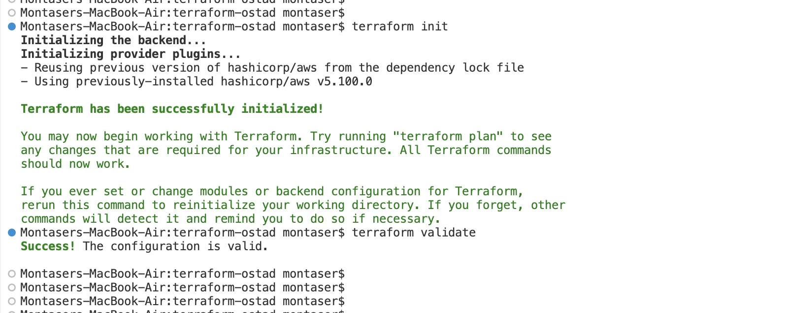

# MILESTONE 01

## EVIDENCE FOR MAYA

- GitHub repository with the Terraform skeleton committed:
  [muntaseri/terraform-ostad](https://github.com/muntaseri/terraform-ostad).
  Skeleton commit: [`680c1e4`](https://github.com/muntaseri/terraform-ostad/commit/680c1e44de7216135cc2053cfb250d23a2e10b7a)
  (`GitHub repo link with the skeleton`).

# Why Remote State and Locking Matter for Teams

Remote state gives everyone on a team a shared, current record of the
infrastructure Terraform manages. Without it, each person may work from a
different local state file, causing configuration drift or plans that miss
resources created by teammates. A remote backend also makes state accessible
from multiple machines and can provide centralized access controls, encryption,
and backups or versioning.

State locking prevents two Terraform operations from modifying the same state
at the same time. Without a lock, concurrent applies can overwrite state updates
or leave the state inconsistent with the actual infrastructure. Locking allows
one operation to proceed while others wait or fail safely, reducing the risk of
conflicting changes and difficult recovery.

## What If Two People Run `terraform apply` at the Same Time?

Without locking, you and Sam could both plan against the same old state and
then make conflicting changes. Terraform might try to create or update the same
resources twice, and one apply could overwrite the other's state update. The
actual AWS resources and the recorded Terraform state could then disagree,
leaving duplicate or unmanaged resources and requiring manual recovery. With
locking enabled, one apply holds the state lock while it runs; the other waits
or fails safely instead of changing the state concurrently.

# MILESTONE 02

## EVIDENCE FOR MAYA

- VPC implementation: [`modules/vpc/main.tf`](modules/vpc/main.tf), with module
  inputs and outputs in [`modules/vpc/variables.tf`](modules/vpc/variables.tf)
  and [`modules/vpc/outputs.tf`](modules/vpc/outputs.tf).
- Root module call: [`main.tf`](main.tf).
- Plan summary, generated with
  `terraform plan -refresh=false -input=false -var-file=terraform.tfvars.example`:
  **Plan: 23 to add, 0 to change, 0 to destroy.** This is a plan only; no
  resources were applied.
- Network diagram: [`diagrams/vpc-network.drawio`](diagrams/vpc-network.drawio).

## DESIGN REVIEW

### 1. Why can app servers in private subnets reach the internet?

Private app subnets have no public IPs and do not route directly to the
Internet Gateway. Their route tables send outbound `0.0.0.0/0` traffic through
a NAT Gateway in a public subnet. The NAT Gateway sends that traffic out
through the Internet Gateway and translates the source address. Return traffic
is allowed back through the established connection, while unsolicited inbound
internet connections cannot directly reach the app servers.

### 2. What is the trade-off between one NAT Gateway and one per AZ?

A single NAT Gateway costs less because there is only one hourly charge and
one set of data-processing charges. Both AZs' private subnets share it, though,
so they depend on that AZ and traffic from the other AZ crosses zones, adding
latency and possible cross-AZ data-transfer cost.

One NAT Gateway per AZ costs more, but each AZ's private subnets can use their
local NAT Gateway. This avoids the cross-AZ NAT path and reduces the impact of
a single-AZ failure on outbound connectivity. The configuration defaults to
one NAT in `dev` and one per AZ in `prod`.

# MILESTONE 03

## EVIDENCE FOR DANIEL

Security group module: [`modules/security_groups/main.tf`](modules/security_groups/main.tf).
Ingress and egress are managed with separate VPC security group rule resources.

| Security group | Inbound rules | Outbound rules |
| --- | --- | --- |
| ALB | TCP 80 and 443 from `0.0.0.0/0` | TCP 80 to the App SG |
| App | TCP 80 from the ALB SG; TCP 22 from the Bastion SG | TCP 3306 to the DB SG; TCP 80 and 443 to `0.0.0.0/0` (via NAT) |
| DB | TCP 3306 from the App SG | None |
| Bastion | TCP 22 only from `allowed_ssh_cidr` when configured; disabled by default | TCP 22 to the App SG |

## DESIGN REVIEW

### 1. Why is referencing a security group ID safer than allowing a CIDR range?

An SG reference limits access to network interfaces associated with that
specific security group, rather than every address in a subnet or broad IP
range. Private IPs can change as instances are replaced or scaled, while the
SG-based trust relationship continues to apply. This narrows the set of
permitted sources and avoids accidentally trusting unrelated workloads that
share an address range.

### 2. If the ALB is compromised, what can an attacker reach directly?

The ALB security group can initiate connections only to app servers on TCP 80.
The app SG accepts that port from the ALB SG, and the DB SG accepts MySQL only
from the app SG, so the compromised ALB cannot directly reach the database or
SSH to app servers. An attacker could still exploit the application through
the allowed HTTP path; the app tier can then reach the DB on TCP 3306 and make
outbound HTTP/HTTPS requests. The ALB itself can also receive public HTTP and
HTTPS traffic.

# MILESTONE 04

## EVIDENCE FOR MAYA

- ALB and app implementations: [`modules/alb/main.tf`](modules/alb/main.tf),
  [`modules/app/main.tf`](modules/app/main.tf), and
  [`modules/app/user_data.sh.tftpl`](modules/app/user_data.sh.tftpl).
- Root wiring and ALB DNS output: [`main.tf`](main.tf) and
  [`outputs.tf`](outputs.tf).
- After applying in AWS, capture:
  1. The nginx page at the ALB DNS name across several requests, showing
     hostname and AZ.
  2. An SSM Session Manager shell on an Auto Scaling Group instance.
  3. Auto Scaling activity history showing a manually terminated instance
     replaced without reducing desired capacity.
  4. CloudWatch CPU and Auto Scaling activity showing scale-out during a
     bounded CPU load.

These runtime drills require AWS credentials and an apply; they have not been
run as part of this configuration change.

## DESIGN REVIEW

### 1. What attack does IMDSv2 protect against?

IMDSv2 requires a session token obtained through a PUT request and supplied on
metadata requests. This makes it harder for common Server-Side Request Forgery
(SSRF) vulnerabilities to retrieve instance metadata and temporary IAM
credentials, particularly when an attacker can only induce a simple HTTP GET.
It is defense in depth, not a guarantee against every SSRF technique or a
compromised instance.

### 2. What happens to running instances when user data changes with instance refresh enabled?

Changing rendered user data changes the launch template version. On apply, the
Auto Scaling Group's rolling instance refresh gradually replaces existing
instances with new instances launched from that version. User data runs when
each replacement boots; it is not rerun on existing instances in place. The
configured minimum healthy percentage and warm-up period control replacement
pacing, and the ALB health check controls when replacements become healthy
targets.