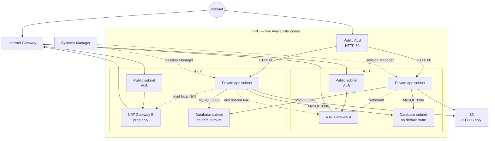

# terraform-ostad

Reusable Terraform configuration for AWS.

## Architecture

The same root configuration deploys dev or prod based on a checked-in,
non-secret tfvars file. Network and application tiers span two Availability
Zones. The ALB is internet-facing; app instances are private and managed by an
Auto Scaling Group; the database is isolated in subnets with no internet
default route. The optional bastion is disabled in both environments and
Session Manager is the preferred administrative path.




Open [`diagrams/vpc-network.drawio`](diagrams/vpc-network.drawio) in draw.io to
view or edit the architecture diagram.

## Configure and validate

Copy `terraform.tfvars.example` to `terraform.tfvars` and set the values for
your deployment. The local `terraform.tfvars` file is ignored by Git.

```sh
cp terraform.tfvars.example terraform.tfvars
terraform init
terraform validate
```

For AWS deployment, first configure credentials, create the state bucket, and
enable the S3 backend as described under
[separate state](#separate-state-per-environment). The plain `terraform init`
above is for local validation only.

The AWS provider uses `aws_region`. It applies `Project`, `Environment`, and
`Owner` as default tags to supported resources. `environment` accepts only
`dev` or `prod`.

## Deploy dev or prod

`dev.tfvars` and `prod.tfvars` contain environment-specific sizing and
availability settings only; they contain no credentials. Do not put passwords,
access keys, or other secrets in either file.

Initialize the S3 backend with the matching state key (see
[separate state](#separate-state-per-environment)), then plan and apply:

```sh
# Dev
terraform init -reconfigure \
  -backend-config="key=terraform-ostad/dev/terraform.tfstate"
terraform plan -var-file=dev.tfvars
terraform apply -var-file=dev.tfvars

# To switch this working copy to prod, reconfigure the backend first.
terraform init -reconfigure \
  -backend-config="key=terraform-ostad/prod/terraform.tfstate"
terraform plan -var-file=prod.tfvars
```

Review plans carefully before applying, especially for production. The
production plan is intentionally not applied by these instructions.

## Environment settings

| Setting | Dev | Prod | Purpose |
| --- | --- | --- | --- |
| `environment` | `dev` | `prod` | Resource names and tags |
| `single_nat_gateway` | `true` | `false` | One shared NAT vs. one per AZ |
| App instance type | `t3.micro` | `t3.small` | App compute size |
| App min / desired / max | `1 / 1 / 2` | `2 / 2 / 6` | Auto Scaling capacity |
| RDS instance class | `db.t3.micro` | `db.t3.small` | MySQL compute size |
| `db_multi_az` | `false` | `true` | Standby/failover availability |
| `db_deletion_protection` | `false` | `true` | Guard against accidental deletion |
| Backup retention | 1 day | 7 days | Automated backup recovery window |
| `db_skip_final_snapshot` | `true` | `false` | Snapshot behavior at deletion |
| `enable_bastion` | `false` | `false` | Bastion exists only when explicitly enabled |

Both environments use two AZs, the same VPC CIDR, S3 controls, security-group
rules, and an HTTP ALB. See [`dev.tfvars`](dev.tfvars) and
[`prod.tfvars`](prod.tfvars) for exact values. Set `allowed_ssh_cidr` to a
public IPv4 `/32` only when intentionally enabling bastion SSH; Session
Manager is preferred.

## Root variable reference

| Variable | Type | Default | Description |
| --- | --- | --- | --- |
| `project_name` | string | required | Project name used in names and tags |
| `environment` | string | `dev` | `dev` or `prod` |
| `aws_region` | string | `us-east-1` | AWS deployment region |
| `vpc_cidr` | string | `10.0.0.0/16` | VPC IPv4 CIDR |
| `owner` | string | `terraform` | Default Owner tag |
| `single_nat_gateway` | bool or null | environment default | One NAT in dev; per-AZ NAT in prod |
| `allowed_ssh_cidr` | string or null | `null` | Optional administrator IPv4 `/32` |
| `app_instance_type` | string | `t3.micro` | App EC2 type |
| `app_min_size` | number | `2` | Minimum ASG capacity |
| `app_desired_capacity` | number | `2` | Desired ASG capacity |
| `app_max_size` | number | `4` | Maximum ASG capacity |
| `db_name` | string | `appdb` | Initial MySQL database |
| `db_instance_class` | string | `db.t3.micro` | RDS instance class |
| `db_multi_az` | bool or null | dev false / prod true | Override RDS Multi-AZ |
| `db_deletion_protection` | bool or null | dev false / prod true | Override RDS deletion protection |
| `db_backup_retention_period` | number or null | dev 1 / prod 7 | Automated backup retention days |
| `db_skip_final_snapshot` | bool or null | dev true / prod false | Whether deletion skips final snapshot |
| `enable_bastion` | bool | `false` | Create an optional bastion EC2 instance |
| `bastion_instance_type` | string | `t3.micro` | Bastion EC2 type when enabled |
| `bastion_key_name` | string or null | `null` | Optional EC2 key pair; SSM is preferred |

## VPC layout

The VPC module selects two available AZs in `aws_region` and creates public,
private application, and isolated database subnets in each. Subnet CIDRs are
calculated from `vpc_cidr` with `cidrsubnet()`. The public subnets route through
an Internet Gateway; private subnets route outbound through NAT; database
subnets have no internet route.

`single_nat_gateway` defaults to `true` in `dev` and `false` in `prod`. Set it
explicitly in `terraform.tfvars` to override that behavior. A single NAT costs
less but is shared across both AZs; two NAT gateways provide per-AZ egress
availability. Root outputs expose the VPC ID and the public, private, database,
and combined subnet ID lists.

## Security groups

The security group module follows a tiered trust model: public HTTP/HTTPS
reaches the ALB; app HTTP is allowed only from the ALB; and MySQL is allowed
only from the app security group. Bastion SSH ingress is disabled by default.
To enable it, set `allowed_ssh_cidr` to your public IPv4 address in `/32`
notation; app SSH is accepted only from the bastion security group.

Egress is scoped to the required paths: ALB to app on TCP 80, app to database
on TCP 3306 and outbound HTTP/HTTPS via NAT, and bastion to app on TCP 22 plus
HTTPS to Systems Manager endpoints.
Security groups are stateful, so return traffic for allowed connections does
not require a broad reverse-direction rule. The database security group has no
initiated egress rule.

## Self-healing nginx web tier

The internet-facing ALB listens on HTTP port 80 and forwards to an instance
target group with an HTTP `/` health check. The app module launches the latest
Amazon Linux 2023 x86_64 AMI in the private subnets, installs nginx, starts the
AMI's preinstalled SSM agent, and serves a page showing the instance hostname,
availability zone, and environment.

The launch template requires IMDSv2, encrypts the root EBS volume, and assigns
an instance profile with `AmazonSSMManagedInstanceCore`. The Auto Scaling Group
uses ELB health checks, a rolling instance refresh, and target tracking at 50%
average CPU. Capacity and instance type are configurable with `app_min_size`,
`app_desired_capacity`, `app_max_size`, and `app_instance_type`.

After applying in an AWS account, get the web endpoint with:

```sh
terraform output -raw alb_dns_name
```

Open `http://<alb_dns_name>` or repeatedly run `curl` against that URL to
observe requests served by registered instances. The endpoint output does not
exist until the infrastructure has been applied.

For Session Manager, select an instance in the Auto Scaling Group and connect
without SSH keys:

```sh
aws ssm start-session --target <instance-id>
```

For a controlled replacement drill, terminate one instance without decreasing
the desired capacity:

```sh
aws autoscaling terminate-instance-in-auto-scaling-group \
  --instance-id <instance-id> \
  --no-should-decrement-desired-capacity
```

Verify in the Auto Scaling Group activity history that a replacement launches
and becomes healthy in the target group. For a scaling drill, connect with SSM
and run a bounded CPU workload, for example
`sudo dnf install -y stress-ng && stress-ng --cpu 2 --timeout 10m`. Observe the
CloudWatch CPU metric and Auto Scaling activity history; target tracking may
take several minutes to add capacity. These drills can incur AWS charges.

## RDS and S3 data protection

The RDS module creates a MySQL DB subnet group from the isolated database
subnets and a storage-encrypted, non-public DB instance protected by the
database security group. RDS generates and manages the master password in
Secrets Manager. Terraform exposes only the endpoint and secret ARN, never the
password. The app instance role can call `secretsmanager:GetSecretValue` for
that one secret so an authorized Session Manager session can connect to MySQL.

Database defaults follow the environment: dev uses Single-AZ, no deletion
protection, one day of backups, and skips the final snapshot; prod uses
Multi-AZ, deletion protection, seven days of backups, and retains a final
snapshot. Override these with `db_multi_az`, `db_deletion_protection`,
`db_backup_retention_period`, and `db_skip_final_snapshot`. The class and
initial database name use `db_instance_class` and `db_name`.

The S3 module creates a globally unique bucket with a random suffix, versioning,
AES-256 server-side encryption, bucket-owner-enforced ownership, all public
access blocks, and a bucket policy that denies non-TLS requests.

### Verify database secret access from an app instance

After applying, copy the following endpoint and secret ARN values from
`terraform output` into the Session Manager shell on an app instance. The
instance role grants read access only to this RDS-generated secret. This uses a
temporary, permission-restricted MySQL client file so the password is not put
on the command line:

```sh
DB_HOST="<hostname from terraform output -raw db_endpoint, without :3306>"
SECRET_ARN="<value from terraform output -raw db_master_user_secret_arn>"
DB_NAME="<value from terraform output -raw db_name>"
SECRET_JSON="$(aws secretsmanager get-secret-value \
  --secret-id "$SECRET_ARN" \
  --query SecretString --output text)"
MYSQL_CNF="$(mktemp)"
chmod 600 "$MYSQL_CNF"
printf '[client]\nhost=%s\nuser=%s\npassword=%s\n' \
  "$DB_HOST" \
  "$(jq -r .username <<< "$SECRET_JSON")" \
  "$(jq -r .password <<< "$SECRET_JSON")" > "$MYSQL_CNF"
mysql --defaults-extra-file="$MYSQL_CNF" "$DB_NAME"
# At the mysql> prompt, run: SELECT CURRENT_USER(), DATABASE();
# Type exit to return to the shell, then remove the temporary credentials file:
rm -f "$MYSQL_CNF"
unset SECRET_JSON
```

Capture the successful MySQL query in the Session Manager terminal for the
compliance evidence. Avoid printing the secret JSON or password in screenshots
or logs.

### Verify S3 denies HTTP

With AWS CLI credentials authorized to write to the bucket, upload a temporary
object, create a short-lived presigned URL, then change only its scheme to
HTTP. The HTTPS request should succeed and the HTTP request should receive
`403 AccessDenied` from the `aws:SecureTransport` bucket-policy deny:

```sh
BUCKET="$(terraform output -raw s3_bucket_name)"
printf 'TLS policy check\n' > /tmp/s3-tls-check.txt
aws s3 cp /tmp/s3-tls-check.txt "s3://$BUCKET/tls-check.txt"
URL="$(aws s3 presign "s3://$BUCKET/tls-check.txt" --expires-in 60)"
curl -i "$URL"
curl -i "${URL/https:/http:}"
aws s3 rm "s3://$BUCKET/tls-check.txt"
rm -f /tmp/s3-tls-check.txt
```

Capture the HTTP response showing `403 AccessDenied` for the evidence. Remove
the temporary object afterward if no longer needed.

## Root outputs

| Output | Description |
| --- | --- |
| `vpc_id` | VPC ID |
| `public_subnet_ids`, `private_subnet_ids`, `database_subnet_ids`, `all_subnet_ids` | Subnet ID lists by tier and combined |
| `alb_dns_name` | Public ALB DNS hostname |
| `app_autoscaling_group_name` | App Auto Scaling Group name |
| `alb_security_group_id`, `app_security_group_id`, `database_security_group_id`, `bastion_security_group_id` | Security group IDs |
| `db_endpoint` | MySQL endpoint hostname and port |
| `db_name` | Initial database name |
| `db_master_user_secret_arn` | ARN only; never outputs the password |
| `s3_bucket_name`, `s3_bucket_arn` | Application bucket name and ARN |
| `bastion_instance_id`, `bastion_public_ip` | Values when the optional bastion is enabled; otherwise `null` |

Use `terraform output -raw alb_dns_name` or
`terraform output -raw db_endpoint` to retrieve individual scalar outputs.

## Separate state per environment

Use separate S3 object keys for dev and prod (for example,
`terraform-ostad/dev/terraform.tfstate` and
`terraform-ostad/prod/terraform.tfstate`). This keeps each environment's state,
locking, and history separate while keeping one shared module implementation.
It is safer than relying on a workspace selection in a shared working copy:
the backend key is explicit in the deployment command and can be isolated
further with separate IAM permissions and pipelines. For high-assurance
production, use a separate AWS account and a separately controlled state
bucket/backend as well.

The backend block in `backend.tf` is commented by default. Create the
state bucket out of band, then uncomment the block and set its bucket and
region. Keep `key` as the dev default or supply an explicit key each time with
`terraform init -reconfigure -backend-config="key=..."`. Never point two
environments at the same state key.

## Approximate monthly cost

Indicative us-east-1 on-demand estimates for 730 hours/month, excluding taxes,
free-tier credits, data transfer, request/LCU usage, and backup growth:

| Environment | Approximate baseline | Major components |
| --- | ---: | --- |
| Dev | **about $75–100/month** | One NAT Gateway (~$33), ALB (~$16 plus LCU), one `t3.micro` app (~$8), one `db.t3.micro` (~$12 plus storage) |
| Prod | **about $160–220/month** | Two NAT Gateways (~$66), ALB (~$16 plus LCU), two minimum `t3.small` apps (~$30), Multi-AZ `db.t3.small` (~$50 plus storage/backups) |

These are planning estimates, not AWS quotes; NAT and data-processing charges
can increase materially with traffic. Check current pricing for the chosen
region and instance availability before deployment. The three largest cost
drivers are typically NAT Gateways/data processing, RDS (especially Multi-AZ),
and the always-on compute/load-balancing tier (EC2 and ALB).

## Teardown

Destroy only the environment whose state key and tfvars file you have verified.
Production deletion protection must be explicitly disabled before RDS can be
deleted; preserve or confirm the final snapshot first. S3 buckets must be empty
before Terraform can delete them, and their versions/delete markers must also
be removed. Review the destroy plan before confirming:

```sh
# Select dev state, then review and destroy dev.
terraform init -reconfigure \
  -backend-config="key=terraform-ostad/dev/terraform.tfstate"
terraform plan -destroy -var-file=dev.tfvars
terraform destroy -var-file=dev.tfvars
```

For prod, use the prod state key and `prod.tfvars` only after an approved
maintenance window, backup/final-snapshot review, and removal of deletion
protection. Destroying the stack incurs no Terraform command fee, but retained
snapshots and S3 versions can continue to incur storage charges.

## Pull request CI

The GitHub Actions workflow at
[`terraform-ci.yml`](.github/workflows/terraform-ci.yml) runs formatting,
initialization, validation, TFLint, and Checkov for every pull request. It
creates a plan with `dev.tfvars` and comments only the resource action counts;
it does not post the raw plan or apply changes.

The PR plan currently disables the backend and refresh, so it is a static
proposal based on an empty state—not a drift-aware plan against deployed dev
state. To enable the AWS-dependent data lookups and plan comment, configure the
repository variable `AWS_ROLE_TO_ASSUME` with a dedicated read-only IAM role
trusted for this repository's GitHub Actions OIDC identity. Optionally set
`AWS_REGION` as a repository variable; otherwise `us-east-1` is used. The role
should be limited to required describe operations such as EC2 availability-zone
and AMI lookups. Do not grant apply, destroy, or state-write permissions to the
PR plan role. Forked PRs never receive AWS credentials; they run static checks
only, because GitHub does not grant their workflows permission to post comments.

Configure the role trust policy for GitHub's OIDC provider
(`token.actions.githubusercontent.com`) with audience `sts.amazonaws.com` and
subject `repo:<owner>/<repository>:pull_request`. Grant only the read actions
needed by Terraform data sources, currently `ec2:DescribeAvailabilityZones`
and `ec2:DescribeImages` on `*`. In repository settings, add `AWS_ROLE_TO_ASSUME`
as an Actions variable (not a secret); optionally add `AWS_REGION`. Internal PR
code can execute in the plan job, so use a dedicated read-only role and do not
trust this role for deployment.

For a state-aware plan, first enable the remote S3 backend and separately
design a protected dev-state workflow with tightly scoped state access.

## Enable the S3 remote backend

Create the Terraform state bucket manually before uncommenting the S3 backend
block in `backend.tf`. Use a unique bucket name, versioning, server-side
encryption, and all public access blocks. The AWS identity needs access to the
bucket and permission to create/delete the `.tflock` object. Backend
configuration cannot use Terraform variables. For a first migration from local
state, initialize with the correct environment key and `-migrate-state`.

## Recreate the module directory layout

Run this Bash snippet from the repository root to create the module folders and
their standard Terraform files:

```bash
for module in vpc security_groups alb app rds s3 bastion; do
  mkdir -p "modules/$module"
  touch "modules/$module/main.tf" \
    "modules/$module/variables.tf" \
    "modules/$module/outputs.tf"
done
```
